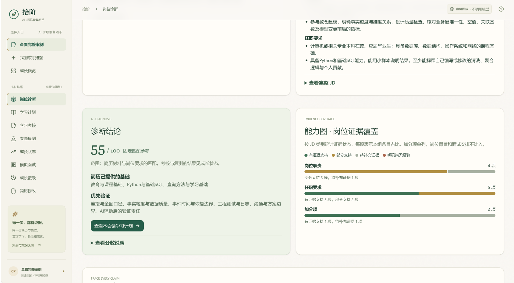

# 拾阶 · AI 求职准备助手

拾阶接收简历和目标岗位 JD，帮助求职者找出已有证据、待补充的能力和下一步准备方向。诊断结论可以回溯到原文，简历修改建议经过用户确认后保存。

## 界面截图

### 首页


### 求职资料


### 岗位诊断



## 功能与实现

- **岗位诊断**。通过 OpenAI 兼容 SDK 接入 DeepSeek，解析结构化输出并校验简历原文引用。
- **简历优化与短面试**。并排展示原简历和修改草稿，标注修改依据。支持一轮模拟面试和回答复盘。
- **请求恢复**。记录请求状态与回执，支持重复提交保护、刷新恢复和历史结果查看。
- **完整案例**。使用虚构资料回放岗位诊断、14 天学习与考核、专题复测、模拟面试和简历修订。

真实模型入口覆盖岗位诊断、简历优化和短面试。学习计划、考核和复测通过离线案例查看。现有 [HTTP/SDK 回归记录](源码/normal-http-summary.json) 使用数据开发、游戏开发和 Agent 工程三组样例，覆盖保存、重复提交和刷新恢复。

## 本地运行

在 Windows 上安装 Python 3.11 或更新版本，然后在仓库根目录运行以下命令。页面使用随仓库提供的前端构建产物。

```powershell
python -m pip install "pydantic>=2.10,<3"
python "源码/scripts/delivery_launcher.py" serve --offline-verification --data-dir ".local-demo" --port 5180
```

打开 [http://127.0.0.1:5180/#welcome](http://127.0.0.1:5180/#welcome)，选择「查看完整案例」。离线模式无需 API Key。按 `Ctrl+C` 停止服务。真实模型接入可参考 [网关部署文档](源码/deploy/judge-gateway/README.md)，使用自行配置的服务端凭据。

## 技术与目录

| 部分 | 技术 | 目录 |
| --- | --- | --- |
| Web 界面 | React、TypeScript、Vite、Radix UI | [源码/ui-prototype](源码/ui-prototype) |
| 工作流与会话 | Python、SQLite、Pydantic、OpenAI 兼容 SDK | [源码/src](源码/src) |
| 模型网关 | Python、HTTPX、PostgreSQL | [源码/deploy/judge-gateway](源码/deploy/judge-gateway) |
| 本地样例 | 虚构简历、JD 与案例回放 | [评委测试资料](评委测试资料)、[源码/seed](源码/seed) |

代码以 [MIT 许可证](LICENSE) 发布。依赖许可见 [第三方许可](第三方许可)。
