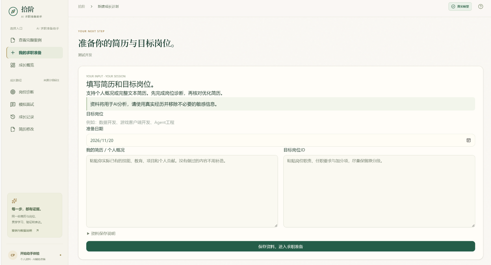

# 拾阶 · AI 求职准备助手

拾阶接收简历和目标岗位 JD，帮助求职者找出已有证据、待补充的能力和下一步准备方向。诊断结论可以回溯到原文，简历修改建议经过用户确认后保存。

2026-11-26 新增求职准备智能体。模型通过原生 Function Calling 选择工具，读取当前资料、检索历史记录和本地学习资源、核对简历引用并保存任务计划。提交完成结果或受阻原因后，会自动启动新一轮规划，结合工具返回结果调整待办任务。

## 界面截图

### 首页


### 求职资料



### 岗位诊断


## 功能与实现

- **岗位诊断**。通过 OpenAI 兼容 SDK 接入 DeepSeek，解析结构化输出并校验简历原文引用。
- **简历优化与短面试**。并排展示原简历和修改草稿，标注修改依据。支持一轮模拟面试和回答复盘。
- **请求恢复**。记录请求状态与回执，支持重复提交保护、刷新恢复和历史结果查看。
- **智能体业务闭环**。自主调用岗位诊断、简历优化和一轮短面试，读取真实作答的模型复盘后修订任务。包含会话记忆、任务版本、工具结果回传、重复保护、停止及费用预占。每轮最多 8 轮决策、12 次模型请求（含业务调用）、16 次工具调用。
- **完整案例**。使用虚构资料回放岗位诊断、14 天学习与考核、专题复测、模拟面试和简历修订。

原求职流程的真实模型入口覆盖岗位诊断、简历优化和短面试，学习计划、考核和复测可通过完整案例查看。智能体复用真实业务执行器，在个人会话内推进准备流程并管理独立任务计划。现有 [HTTP/SDK 回归记录](源码/normal-http-summary.json) 使用数据开发、游戏开发和 Agent 工程三组样例，覆盖保存、重复提交和刷新恢复。

## 本地运行

### 智能体入口

Windows 运行包双击 [一键启动.cmd](一键启动.cmd)，在「开始动手体验」中填写简历和 JD，进入「成长概览」。默认加载平台内置连接，模型设置统一用于岗位诊断、简历优化、模拟面试和智能体。

在「全平台模型连接」中填写自己的 OpenAI 兼容模型地址、模型名称、API Key 和人民币单价，保存后所有功能的新请求统一使用用户连接。可点击「恢复平台内置API」切回默认连接。密钥通过 Windows DPAPI 在本机加密保存，旧调用按各自冻结的配置和单价保留回执，未派发的旧配置请求会失效。

智能体每轮费用上限默认 0.50 元，按有效配置单价和模型用量预占、结算。平台已在原 Render 服务部署 [网关工具调用升级](源码/deploy/judge-gateway/render)，启动时读取网关公布的能力，界面据此显示智能体连接是否就绪。

点击「开始自主准备」后，模型按目标选择工具。默认目标会推进岗位诊断、简历草稿与面试提问。在面板中填写「我的回答」并点击「提交回答，复盘并继续」，智能体会保存用户原话、调用面试复盘，再依据复盘更新任务。简历草稿展示原文、修改依据及整稿预览，用户选择条目后点击「已核对，保存此版简历」。

九个工具包括 `read_context`、`search_history`、`search_resources`、`check_resume_quotes`、`save_plan`，以及 `diagnose_job`、`optimize_resume`、`start_mock_interview`、`review_mock_interview`。业务适配器见 [career_agent_business.py](源码/src/career_agent_business.py)。它复用原有预览、费用预占、一次派发、结果校验和回执恢复流程。业务请求计入智能体本轮预算，并继续受原会话与平台额度约束。相同目标已有结果时复用；结果未知或校验失败时保留原回执，不自动重发。

历史检索限定当前会话，资源工具查询本地目录并返回参考链接。学习练习等待用户执行反馈，面试回答只能来自用户界面输入。A/E结果在用户委托下通过程序校验后自动保存，记录标明 `review_actor=career_agent`；简历修改由用户核对后保存。已完成任务保留，服务中断后保留任务、业务结果及未知费用预占。

原生调用格式参考 [DeepSeek Tool Calls 文档](https://api-docs.deepseek.com/guides/tool_calls/)。智能体使用有停止条件的工具循环，默认关闭模型思考模式。

源码启动命令如下。

```powershell
python -m pip install -r "源码/requirements-build.lock"
python "源码/scripts/delivery_launcher.py" start --allow-real-calls --data-dir ".local-demo"
```

### 离线案例

在 Windows 上安装 Python 3.11 或更新版本，然后在仓库根目录运行以下命令。页面使用随仓库提供的前端构建产物。

```powershell
python -m pip install "pydantic>=2.10,<3"
python "源码/scripts/delivery_launcher.py" serve --offline-verification --data-dir ".local-demo" --port 5180
```

打开 [http://127.0.0.1:5180/#welcome](http://127.0.0.1:5180/#welcome)，选择「查看完整案例」。离线模式无需 API Key。按 `Ctrl+C` 停止服务。真实模型接入可参考 [网关部署文档](源码/deploy/judge-gateway/README.md)，使用自行配置的服务端凭据。

## 技术与目录

| 部分 | 技术 | 目录 |
| --- | --- | --- |
| Web 界面 | React、TypeScript、Vite、Radix UI | [源码/ui-prototype](源码/ui-prototype) |
| 工作流与会话 | Python、SQLite、Pydantic、OpenAI 兼容 SDK | [源码/src](源码/src) |
| 模型网关 | Python、HTTPX、PostgreSQL | [源码/deploy/judge-gateway](源码/deploy/judge-gateway) |
| 本地样例 | 虚构简历、JD 与案例回放 | [评委测试资料](评委测试资料)、[源码/seed](源码/seed) |

代码以 [MIT 许可证](LICENSE) 发布。依赖许可见 [第三方许可](第三方许可)。

## 智能体验证

20 项后端回归覆盖原智能体与统一配置能力，以及 A/D/E SDK 业务闭环、真实作答入口、复盘后必须更新计划、用户确认保存简历、相同结果复用、未知响应不重发、同轮预算和 HTTP 并发保护。Windows EXE 使用本机 HTTP 模型替身完成两轮业务执行、14 次模型请求、用户核对保存、重复保护和重启恢复；浏览器实际操作验证生成、作答续接和保存，未发现控制台错误。

2026-11-26 在原 Render 服务使用合成输入完成 2 次真实 DeepSeek 调用，验证工具选择、工具结果回传、最终回答和重复请求缓存，并确认升级前的调用及费用记录保留。该检查覆盖协议链路，求职建议的质量仍须结合实际输入评估。

2026-11-27 又用合成简历与合成作答完成两轮真实业务闭环，覆盖 `a_diagnosis`、`d_revision`、`e_turn`、`e_report` 和复盘后的计划修订，共16次模型请求、记账0.155388元。升级前26次调用及费用记录保留，验证后累计42次调用、395384微元费用，未知费用预占为0。这些协议与流程检查不等于全面的求职建议质量评测。

```powershell
python -m pytest "源码/tests/test_career_agent.py" "源码/tests/test_unified_model.py" "源码/tests/test_career_agent_business.py" -q
python "源码/tests/verify_agent_delivery.py" --executable "ShijieAgent.exe" --business
```

本次前端全量回归 150 项通过，3 项依赖的旧版 `scenario_01`、`scenario_02`、`scenario_03` 案例源文件缺失。新增接口回归和生产构建已通过。
